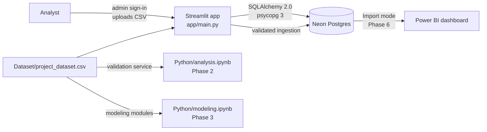

# Cronus — Telecom Churn Intelligence

**Deployed app:** https://churn-lab.streamlit.app/

Cronus is a customer-provider relationship analytics system for telecom churn.
It combines a Python data platform, a scikit-learn churn model, a Streamlit
interface, Neon Postgres, and a later Power BI dashboard. The project is being
built for a Data Analytics with Python and Power BI internship.

The canonical dataset is [`Dataset/project_dataset.csv`](Dataset/project_dataset.csv).
One row is one customer-provider relationship; `customer_id` is intentionally
non-unique. See [`Dataset/README.md`](Dataset/README.md) for the full data
contract and integrity details.

## Status

Phase 1 — foundation and data platform — is implemented and verified:

- Python 3.13 project managed by uv
- SQLAlchemy 2.0 models and Alembic migration for Neon Postgres
- Robust CSV validation and transactional ingestion
- Streamlit page for connection status, active-dataset summary, upload, and
  dataset activation
- Unit tests, a DB-test suite, Ruff, mypy, and GitHub Actions CI
- Baseline snapshot loaded and verified:
  - 10,000 relationships
  - 8,860 unique customers
  - 19.87% relationship churn (1,987 relationships)
  - 9.56% current customer churn (847 latest relationships)
  - 1,020 multi-provider customers and 33 re-entry pairs

Phase 2 — exploratory data analysis — is implemented and verified:

- Executed notebook at [`Python/analysis.ipynb`](Python/analysis.ipynb) with 55
  cells (25 markdown, 30 code) and 12 figures
- Reads the canonical CSV through `cronus.validation.validate_csv`; it needs no
  database, `.env` file, or credentials
- Reports relationship churn and current customer churn separately
- Adds Wilson 95% confidence intervals and descriptive tables
- Trains no model and makes no causal claims
- Runs end to end with all outputs embedded

Phase 3 — current-relationship churn model — is implemented and verified:

- Reusable package at `src/cronus/modeling/` for features, pipelines, evaluation,
  and training
- Executed notebook at [`Python/modeling.ipynb`](Python/modeling.ipynb) with 43
  cells (15 markdown, 28 code) and 10 figures
- Trains on the 8,860 latest relationships only and never on historical rows
- Compares logistic regression with a gradient-boosted tree under five-fold
  stratified cross-validation
- Final model: logistic regression with 10 features and no
  `relationship_count`
- Holdout PR-AUC 0.231, ROC-AUC 0.729, Brier 0.081
- Max-F1 threshold 0.184 gives 0.241 precision and 0.337 recall
- Includes calibration, permutation importance, subgroup recall, and a temporal
  check
- No model artifact, database write, or prediction UI

Phase 4 — analytics UI and admin workflow — is implemented:

- Multipage Streamlit application under `app/` with Overview, Providers and
  segments, Usage and tenure, Model performance, Churn predictions, and Admin
  pages
- Current-relationship reads only: analytics and scoring never use historical
  rows and never deduplicate the current grain
- The fixed Phase 3 logistic model is refitted on the active current frame and
  cached in the Streamlit process with `st.cache_resource`
- Every score display and CSV export carries its decision threshold
- Admin password gate protects upload, replacement, and activation, and fails
  closed when no password is configured
- No model artifact, prediction table, new runtime dependency, or schema change

Phase 5 is complete. Phase 6 is in progress: the Power Query scoring, the DAX
objects, and the build guide are ready, and the PBIX build is pending. Phase 7
is not started.

## Architecture



- The Streamlit application is the only data-loading interface and the only
  application interface. There is no custom CLI, seed script, or console entry
  point.
- The app has six pages. The Admin page is the only place that uploads,
  replaces, or activates a dataset, and it requires a password.
- The Phase 2 and Phase 3 notebooks read the canonical CSV through the
  validation service. They do not connect to Neon.
- Alembic is the only command-line tool used to change the database schema.
- The application uses the pooled Neon URL; Alembic uses the direct URL.

## Stack

| Layer | Choice |
| --- | --- |
| Runtime | Python 3.13 (`>=3.13,<3.14`), managed by uv |
| UI | Streamlit 1.66+ |
| Data | pandas, NumPy |
| Modeling | scikit-learn 1.9 (logistic regression, gradient-boosted tree) |
| Database | Neon Postgres |
| ORM / SQL | SQLAlchemy 2.0, psycopg 3 |
| Migrations | Alembic |
| Validation / config | Pydantic v2, pydantic-settings |
| Notebook / EDA | JupyterLab, ipykernel, matplotlib, seaborn, nbconvert |
| Quality | Ruff, mypy, pytest, pytest-cov |
| CI | GitHub Actions |

## Repository layout

```text
.
├── Dataset/
│   ├── project_dataset.csv        # byte-identical committed dataset
│   └── README.md                  # source, SHA-256, shape, semantics
├── Python/analysis.ipynb          # executed Phase 2 EDA notebook
├── Python/modeling.ipynb          # executed Phase 3 modeling notebook
├── PowerBI/
│   ├── PowerQuery_M_Scoring.txt   # five Power Query queries for scoring
│   ├── DAX_Measures.txt           # measures, columns, fixed evidence tables
│   ├── PBIX_Build_Guide.md        # build steps for the five report pages
│   ├── powerbi_model_export.json  # intercept, 43 coefficients, scaler
│   └── verify_scores.py           # PBIX vs Streamlit parity check
├── GitHub/README.md               # copy of the root README (Phase 7)
├── app/
│   ├── main.py                    # navigation shell and page registration
│   ├── shared.py                  # cached reads, sidebar, and UI helpers
│   └── views/
│       ├── overview.py            # dual-grain snapshot summary
│       ├── providers.py           # provider and segment comparisons
│       ├── usage.py               # tenure, usage, cohorts, correlations
│       ├── performance.py         # Phase 3 model card and checks
│       ├── predictions.py         # scored review queue and CSV export
│       └── admin.py               # password gate, upload, activation
├── src/cronus/
│   ├── __init__.py
│   ├── auth.py                    # constant-time admin password check
│   ├── config.py                  # settings and URL normalisation
│   ├── db.py                      # pooled engine, sessions, status
│   ├── logging.py
│   ├── models.py                  # SQLAlchemy models
│   ├── repository.py              # typed read/activation queries
│   ├── schemas.py                 # Pydantic contracts and errors
│   ├── validation.py              # CSV normalisation and derivation
│   ├── ingest.py                  # transactional ingestion service
│   ├── analytics.py               # current-grain descriptive tables
│   └── modeling/
│       ├── __init__.py            # public modeling API
│       ├── features.py            # feature contract, current frame, splits
│       ├── pipelines.py           # preprocessing, logistic and tree pipelines
│       ├── evaluation.py          # metrics, thresholds, calibration
│       ├── serving.py             # final model contract and batch scoring
│       └── training.py            # CV, tuning, final fit, prediction
├── alembic/
│   ├── env.py
│   ├── script.py.mako
│   └── versions/0001_initial_schema.py
├── tests/
│   ├── conftest.py
│   ├── test_config.py
│   ├── test_auth.py
│   ├── test_analytics.py
│   ├── test_serving.py
│   ├── test_validation.py
│   ├── test_modeling.py
│   ├── test_powerbi_export.py
│   └── test_ingest_db.py
├── .github/workflows/ci.yml
├── .streamlit/config.toml
├── .editorconfig
├── .gitattributes
├── .gitignore
├── .env.example
├── .python-version
├── alembic.ini
├── pyproject.toml
├── uv.lock
└── README.md
```

The untouched local original `telecom_churn.csv` stays at the repository root
and is gitignored. `Dataset/project_dataset.csv` is the canonical committed
copy.

## Quickstart

### 1. Prerequisites

- A Neon project. Copy the pooled and direct connection strings from the Neon
  console.
- [uv](https://docs.astral.sh/uv/) installed. The project prepares `uv` at
  `~/.local/bin` during development:

  ```bash
  curl -LsSf https://astral.sh/uv/install.sh | sh
  export PATH="$HOME/.local/bin:$PATH"
  ```

### 2. Configure the environment

```bash
cp .env.example .env
# Edit .env and fill DATABASE_URL and DIRECT_URL.
# Set ADMIN_PASSWORD to a non-empty value for the Admin page.
```

Never commit `.env`. `DATABASE_URL` must be the pooled Neon URL (its host
contains `-pooler`). `DIRECT_URL` must be the direct, unpooled URL used only by
Alembic. Connection strings are normalised to
`postgresql+psycopg://` with `sslmode=require`; passwords are masked in any
display.

Set the admin password in `.env`:

```bash
ADMIN_PASSWORD=choose-a-long-password
```

The app also accepts a Streamlit secret. Create `.streamlit/secrets.toml`
(gitignored) when you prefer that route:

```toml
admin_password = "choose-a-long-password"
```

The Streamlit secret has priority over `ADMIN_PASSWORD`. If neither value is
set, the Admin page stays locked and upload, replacement, and activation are
unavailable.

### 3. Install and migrate

```bash
uv sync --frozen
uv run alembic upgrade head
```

The migration creates the `datasets` and `customer_relationships` tables. The
application never runs migrations at startup.

### 4. Run the app

```bash
uv run streamlit run app/main.py
```

Open the local Streamlit URL. The default page is **Overview**. To load the
baseline snapshot, open **Admin**, sign in, upload
`Dataset/project_dataset.csv`, give the dataset a name, keep **Activate after
load** checked, and click **Load dataset**.

The app builds the model when you first open **Churn predictions**. The fit runs
in the Streamlit process on the active current-relationship frame. No model file
is written. The six pages are:

1. **Overview** — active snapshot and dual-grain churn
2. **Providers and segments** — provider, gender, age-band, and state tables
3. **Usage and tenure** — tenure bands, usage quartiles, cohorts, and rank
   correlations
4. **Model performance** — fixed Phase 3 model card, thresholds, confusion
   matrix, calibration, subgroup recall, and temporal check
5. **Churn predictions** — scored review queue with filtered and full CSV
   downloads
6. **Admin** — password gate, upload, replacement, and activation

### 5. Run the analysis notebook

The notebook needs no database and no `.env` file. It reads
`Dataset/project_dataset.csv` directly.

```bash
uv sync --group notebook
uv run --group notebook jupyter lab Python/analysis.ipynb
```

To re-execute the notebook in place and refresh every output:

```bash
uv run --group notebook jupyter nbconvert \
  --to notebook --execute --inplace \
  --ExecutePreprocessor.timeout=900 \
  Python/analysis.ipynb
```

### 6. Run the modeling notebook

The Phase 3 notebook needs no database and no `.env` file. It trains on the
current relationships in `Dataset/project_dataset.csv`.

```bash
uv run --group notebook jupyter lab Python/modeling.ipynb
```

To re-execute it in place:

```bash
uv run --group notebook jupyter nbconvert \
  --to notebook --execute --inplace \
  --ExecutePreprocessor.timeout=1800 \
  Python/modeling.ipynb
```

### 7. Run quality checks

```bash
uv run ruff check .
uv run ruff format --check .
uv run mypy src
uv run pytest -m "not db" -q
```

DB tests are opt-in because they write to a dedicated test database:

```bash
# Set TEST_DATABASE_URL to a separate Neon database or branch first.
uv run pytest -m db -q
```

Database tests refuse to run when `TEST_DATABASE_URL` equals `DATABASE_URL`.

## Environment variables

| Variable | Required | Default | Purpose |
| --- | --- | --- | --- |
| `DATABASE_URL` | yes | — | Pooled Neon URL used by the Streamlit app |
| `DIRECT_URL` | no | `DATABASE_URL` | Direct URL used by Alembic; recommended |
| `TEST_DATABASE_URL` | no | — | Separate database/branch for `-m db` tests |
| `APP_ENV` | no | `development` | `development`, `test`, or `production` |
| `LOG_LEVEL` | no | `INFO` | Python logging level |
| `ADMIN_PASSWORD` | no | — | Admin gate for upload, replacement, and activation. Blank keeps the gate locked |
| `MAX_UPLOAD_MB` | no | `25` | Upload size guard |
| `MAX_UPLOAD_ROWS` | no | `200000` | Upload row guard |

Settings are loaded from the repository-root `.env`, independent of the current
working directory. Environment variables take precedence over the file.

## Using the Streamlit app

The app registers six pages with `st.navigation` and `st.Page` in `app/main.py`.
`app/shared.py` owns cached database reads, the sidebar, and reusable display
helpers. Page modules live in `app/views/`.

- **Overview**: active dataset name, snapshot date, registration window,
  unique customers, relationship counts, partner count, multi-provider
  customers, re-entry pairs, and the two churn measures side by side.
- **Providers and segments**: current churn by provider, gender, age band, and
  state. Filters cover provider, gender, state, and age. Tables show counts,
  rates, Wilson 95% intervals, and a small-sample flag.
- **Usage and tenure**: current churn by tenure band, calls/SMS/data quartile,
  and registration year. A Spearman table shows rank associations.
- **Model performance**: the fixed Phase 3 model card, holdout and
  cross-validation metrics, threshold policies, confusion matrix at 0.1840,
  permutation importance, subgroup recall, calibration bins, and the temporal
  check.
- **Churn predictions**: a ranked review queue for the active current frame.
  The page offers the two fixed Phase 3 policies. Every metric label, table
  column, filename, and CSV export carries the selected threshold.
- **Admin**: password gate, upload, replacement, and activation. The gate
  resolves `st.secrets["admin_password"]` first, then `Settings.admin_password`
  from `ADMIN_PASSWORD`. When both are blank, the page fails closed.

Cached reads have a 60-second TTL. The sidebar **Refresh data** button clears
both the data cache and the fitted-model cache. Uploads and activations also
clear both caches. The app does not contain SQL; it calls repository and
ingestion services only.

The model is fitted once per active dataset version and cached with
`st.cache_resource`. It uses the Phase 3 `fit_final_model` and `predict_churn`
functions with fixed hyperparameters, 10 features, and no
`relationship_count`. The app never retunes, changes the feature set, or
reselects a threshold.

Every export includes a `threshold` column, the policy label, the dataset name,
and the snapshot date. Predictions are not written to the database.

## Exploratory analysis

The Phase 2 notebook keeps the relationship grain and reports two churn
measures side by side:

- **Relationship churn (all history):** 1,987 / 10,000 = 19.87%
- **Current customer churn (latest only):** 847 / 8,860 = 9.56%

These rates answer different questions. The notebook never uses 19.87% as the
current customer churn rate.

The notebook covers:

1. Snapshot verification against the Phase 1 contract
2. Grain, duplicate checks, and attribute stability across relationships
3. Univariate distributions
4. Provider, gender, age, dependents, and state comparisons
5. Tenure bands and usage quartiles
6. Spearman correlations and segment interaction
7. Registration cohorts and a Phase 3 feature contract

Main descriptive findings:

- Usage intensity has the strongest association with current churn. Churn
  falls from about 16–18% in the lowest calls, SMS, or data quartile to about 3%
  in the highest quartile.
- BSNL has the highest current churn at 16.0% (266 of 1,664). Reliance Jio has
  the lowest at 5.9% (154 of 2,603).
- Current churn falls from 12.1% for 0–90 days of tenure to 6.6% after two
  years.
- Older age bands and fewer dependents associate with higher current churn.
  Gender shows no material difference.
- Recent registration cohorts show higher current churn, which is consistent
  with their shorter tenure at the snapshot.

All findings are descriptive. The notebook makes no causal claim. The 1,140
historical relationships are churned by dataset construction, so Phase 3 must
model the 8,860 current relationships only.

## Churn modeling

Phase 3 trains and evaluates the churn model on the 8,860 current relationships.
It never uses the 1,140 historical rows. The package is in
`src/cronus/modeling/`, and the executed notebook is `Python/modeling.ipynb`.

### Model card

| Item | Value |
| --- | --- |
| Model | Logistic regression with L2 penalty |
| Grain | One current customer-provider relationship |
| Target | `churn` |
| Training rows | 8,860 |
| Churn events | 847 (9.56%) |
| Features | 10 |
| Validation | Stratified 5-fold CV plus an 80/20 holdout |
| Threshold | 0.184 (max-F1 on out-of-fold predictions) |
| Holdout PR-AUC | 0.231 (95% CI 0.191–0.293) |
| Holdout ROC-AUC | 0.729 (95% CI 0.688–0.765) |
| Holdout Brier | 0.081 (95% CI 0.078–0.083) |
| Artifact | None. Phase 4 refits and caches the pipeline. |

### Scope and feature contract

The loader filters to `is_latest_relationship` and raises an error if a customer
appears twice on that grain. It never deduplicates rows. The target is `churn`
for the latest relationship. The final model uses 10 features:

- Categorical: `telecom_partner`, `gender`, `state`
- Numeric: `age`, `num_dependents`, `estimated_salary`, `calls_made`,
  `sms_sent`, `data_used`, `tenure_days`

The model excludes identifiers (`customer_id`, `record_id`, `dataset_id`,
`source_row_number`), unstable geography (`pincode`, `city`), bookkeeping fields
(`is_latest_relationship`, `relationship_seq`, `created_at`), and
`date_of_registration`. The registration date is used only for the temporal
check. `relationship_count` is tested and dropped after the ablation.

Rare states are grouped with `OneHotEncoder(min_frequency=50)`. Unseen
categories are ignored. All preprocessing is fitted inside the pipeline.

### Validation design

The notebook asserts the file SHA-256 and the 8,860-row current frame before
training. The primary split is stratified 80/20. The test frame has 1,772
relationships and 169 churn events (9.54%). Model selection uses five stratified
folds on the training frame only. PR-AUC is the primary metric because churn is
the minority class at 9.56%. ROC-AUC, Brier score, and log loss are secondary
checks.

| Candidate | Features | CV PR-AUC | CV ROC-AUC | CV Brier |
| --- | ---: | ---: | ---: | ---: |
| Logistic regression | 11 | 0.2676 ± 0.0532 | 0.7499 | 0.0794 |
| Gradient-boosted tree | 11 | 0.2400 ± 0.0475 | 0.7362 | 0.0810 |
| Logistic regression (final) | 10 | 0.2662 ± 0.0493 | 0.7497 | 0.0794 |

The tree loses on PR-AUC and Brier score. Dropping `relationship_count` changes
CV PR-AUC by −0.0014, which is small against the fold standard deviation. The
final model is the simpler 10-feature logistic regression.

### Threshold policy

The default 0.5 threshold is not usable. The model rarely predicts above 0.5,
so 0.5 catches only 2 of 169 holdout churners.

The notebook selects the threshold on out-of-fold training predictions:

- **Max-F1:** 0.1840. Holdout precision 0.241, recall 0.337, F1 0.281.
- **70% recall floor:** 0.0981. Holdout precision 0.172, recall 0.669, F1 0.273.

Max-F1 is the reported policy. The 70% alternative is available when contact
capacity is higher. Every score must travel with its threshold.

### Holdout results

| Metric | Estimate | 95% bootstrap interval |
| --- | ---: | ---: |
| PR-AUC | 0.2312 | 0.1909–0.2926 |
| ROC-AUC | 0.7295 | 0.6884–0.7654 |
| Brier | 0.0806 | 0.0778–0.0834 |

At the max-F1 threshold the confusion matrix is 1,423 true negatives, 180 false
positives, 112 false negatives, and 57 true positives.

### Interpretation and checks

- **Permutation importance:** `telecom_partner` (0.0434), `data_used` (0.0320),
  `calls_made` (0.0231), and `tenure_days` (0.0178) have the largest holdout
  drops. These are associations, not causal effects.
- **Calibration:** the largest quantile-bin gap is −0.036. The curve stays near
  the diagonal, but individual probabilities are not exact churn rates.
- **Subgroup recall:** at the selected threshold, provider recall is BSNL 0.577,
  Airtel 0.375, Vodafone 0.178, and Reliance Jio 0.125. The highest calls
  quartile has 0.000 recall, so high-usage churners are under-flagged.
- **Temporal check:** train on 2020–2021 and test on 2022–2023. Test PR-AUC is
  0.2776, ROC-AUC is 0.7450, and Brier is 0.0941. The newer period has 11.55%
  churn, so prevalence and calibration shift.

### Phase 4 handoff

The app refits the final pipeline on all current relationships of the active
dataset with the selected hyperparameters and threshold. No model artifact is
committed. Phase 4 imports `fit_final_model` and `predict_churn`, fits on the
active dataset, and caches the pipeline in the Streamlit process.

Phase 4 implements the multipage analytics interface, the scored review queue,
and the admin gate. Phase 5 owns public deployment. Phase 4 adds no database
write, schema change, model artifact, or prediction table.

All results are observational. This section reports descriptive and predictive
results only.

## Current-frame analytics and scoring

`get_current_relationships` reads only rows with
`is_latest_relationship = TRUE`. It aliases the database
`registration_date` column to `date_of_registration`, returns the stored
`tenure_days`, normalises dtypes, and raises an error if a customer appears
twice on the current grain. It never deduplicates rows.

`src/cronus/analytics.py` adds the descriptive table helpers used by the pages:

- Wilson 95% churn intervals
- Provider, gender, age-band, and state tables
- Tenure bands, usage quartiles, and registration cohorts
- Spearman rank correlations
- Current-frame filters that reject historical rows and duplicate customers

`src/cronus/modeling/serving.py` holds the fixed Phase 3 serving contract:

- Model: logistic regression with 10 features and `C=0.1`
- Default threshold: 0.1840
- Alternative threshold: 0.0981 at a 70% recall floor
- Model card, permutation importance, subgroup recall, calibration bins, and
  temporal check values
- `fit_scoring_model`, `score_current_relationships`, and `summarize_scores`

The scored queue contains one row per current customer-provider relationship.
It includes `score_rank`, `churn_probability`, `predicted_churn`,
`review_priority`, and a constant `threshold` column. It never includes the
observed `churn` target.

## Admin workflow

The Admin page is the only page with write controls.

1. Resolve the admin password from `st.secrets["admin_password"]`, then from
   `ADMIN_PASSWORD` through `Settings`.
2. Fail closed when both values are missing or blank.
3. Compare the candidate with `hmac.compare_digest`.
4. Lock the form for 60 seconds after five failed attempts in one session.
5. Show upload, replacement, and activation controls only after sign-in.

The password is never displayed, logged, stored in the database, or written to
an export. Sign-in lasts for the Streamlit browser session. The sidebar shows
the lock state and provides sign-out.

Uploads run the existing validation and ingestion services. Validation errors
leave the database unchanged. A byte-identical file offers activation of the
existing dataset or an explicit replacement. Activation is atomic, and a
successful upload or activation clears the data and model caches.

## Data dictionary

### Source columns

| Column | Description |
| --- | --- |
| `customer_id` | Customer identifier; repeats across provider relationships |
| `telecom_partner` | Telecom provider |
| `gender` | `M` or `F` |
| `age` | Age, 15–100 |
| `state` | State name |
| `city` | City name |
| `pincode` | Six-digit pincode; synthetic and not a reliable geographic key |
| `date_of_registration` | Registration date (`DD-MM-YYYY` in the source) |
| `num_dependents` | Dependents, 0–20 |
| `estimated_salary` | Estimated salary, greater than zero |
| `calls_made` | Calls made, non-negative |
| `sms_sent` | SMS sent, non-negative |
| `data_used` | Data used, non-negative |
| `churn` | Provider-specific churn flag, 0 or 1 |

### Derived columns

| Column | Meaning |
| --- | --- |
| `record_id` | Surrogate primary key |
| `dataset_id` | Owning uploaded snapshot |
| `source_row_number` | 1-based source data row, excluding the header |
| `relationship_seq` | 1-based order by `(registration_date, source_row_number)` within customer |
| `relationship_count` | Number of provider relationships for the customer |
| `is_latest_relationship` | True for exactly one relationship per customer |
| `tenure_days` | Historical: next registration minus current. Latest: snapshot date minus current |
| `created_at` | Insertion timestamp (UTC) |

## Grain and churn semantics

This section is the most important part of the data contract.

- **Relationships vs customers**: 10,000 rows are 10,000 customer-provider
  relationships, not 10,000 customers. There are 8,860 unique customers.
- **Multi-provider customers**: 1,020 customers have multiple relationships
  (900 with two, 120 with three). This is intentional. Never deduplicate them,
  reject them, or warn that they are duplicates.
- **Re-entry pairs**: 33 customer-provider pairs recur at a later date
  (for example A → B → A). They are legitimate return relationships.
- **Historical relationships**: 1,140 rows are non-latest relationships. All
  1,140 are churned by dataset construction. Do not treat that as independent
  evidence of churn behaviour.
- **Relationship churn**: 1,987 / 10,000 = **19.87%**. This covers all history.
- **Current customer churn**: 847 / 8,860 latest relationships = **9.56%**.
- **Never mix the two rates.** 19.87% is not the current customer churn rate.
- **Tenure**: the dataset has no explicit churn date. For a historical
  relationship, the next registration date is the proxy switch date. For the
  latest relationship, the snapshot date (`2023-05-04`) is the end of
  observation.
- **Pincode**: pincode changes across all 1,020 multi-provider groups and is
  synthetic noise. It is not a reliable geographic key.
- **ML implication**: Phase 3 models current/latest relationships only.
  Including historical rows would leak the construction rule that every
  non-latest relationship is churned.

## Database schema

### `datasets`

One row per uploaded CSV snapshot:

- UUID primary key, display name, original filename
- unique SHA-256 file hash
- relationship `row_count`, snapshot `as_of_date`
- JSONB `validation_report`
- `is_active` flag with a partial unique index enforcing at most one active
  dataset
- upload timestamp and optional notes

### `customer_relationships`

One row per customer-provider relationship:

- `record_id BIGSERIAL` primary key
- `dataset_id` foreign key with `ON DELETE CASCADE`
- all 14 source fields
- `source_row_number`, `relationship_seq`, `relationship_count`,
  `is_latest_relationship`, `tenure_days`
- check constraints for ranges, six-digit pincodes, sequence consistency, and
  tenure
- unique `(dataset_id, source_row_number)`; **no unique constraint on
  `customer_id`**
- indexes for dataset, churn, latest-churn, customer/date, partner, and state
  access paths

Constraint names follow a stable naming convention (`pk_`, `fk_`, `uq_`, `ck_`,
`ix_`). The initial Alembic revision is reversible.

## Validation and ingestion

`validate_csv` reads UTF-8 with BOM tolerance, keeps every source value as text
while parsing, and normalises:

- trimmed strings
- gender to `M`/`F`
- dates parsed as `DD-MM-YYYY`, then `YYYY-MM-DD`
- six-digit pincodes, including zero-padding and Excel `.0` artifacts
- churn to a boolean
- relationship sequence, latest flag, and tenure

Hard errors (nothing is written):

- empty file or no data rows
- missing or duplicate required columns
- missing values, unparseable dates, non-numeric numbers
- invalid churn values, invalid gender, bad pincodes
- out-of-range age/dependents/salary and negative metrics
- an `as_of_date` earlier than the latest registration date

Warnings (allowed):

- extra columns are dropped
- pincode normalisation
- gender inconsistency for the same customer
- duplicate registration dates that need source-row tie-breaking

Multi-provider records, re-entry pairs, and churned historical relationships are
never warnings.

`ingest_dataframe` recomputes all derived fields, checks the SHA-256 duplicate
hash, optionally replaces an existing dataset, deactivates other datasets when
activating, and inserts the snapshot and all relationships in one transaction.
The app calls this service; no SQL lives in `app/`.

## Testing

| Command | Purpose |
| --- | --- |
| `uv run ruff check .` | Lint all Python |
| `uv run ruff format --check .` | Formatting check |
| `uv run mypy src` | Strict typing for `src` |
| `uv run pytest -m "not db" -q` | Unit tests, no database required |
| `uv run pytest -m db -q` | DB tests against `TEST_DATABASE_URL` |

The unit suite covers the baseline metrics, relationship derivation, error and
warning rules, URL normalisation, password masking, upload limits, admin
password verification, current-frame analytics, and the serving contract. The
analytics tests check Wilson intervals, segment coverage, ordered bands, usage
quartiles, cohorts, filters, and rejection of historical or duplicate current
rows. The serving tests check the fixed constants, model fit on the full current
frame, score coverage, threshold flags, review-priority bands, summary counts,
and input immutability. DB tests create the schema in the test database, ingest
the baseline, verify dual-grain metrics, duplicate rejection, replacement, and
activation, then drop their tables. They are excluded from CI.

The Phase 2 notebook verifies the snapshot before analysis. It asserts the file
SHA-256, file size, 10,000 rows, 8,860 customers, 1,987 relationship churn
events, 1,140 historical churned rows, and 847 current churn events. A full
`nbconvert` execution must produce 30 code cells with sequential execution
counts, no error output, and no stderr output.

The Phase 3 notebook retrains both candidates and the final model. A full
`nbconvert` execution must produce 28 code cells with sequential execution
counts, 10 figures, no error output, and no stderr output.

## Roadmap

| Phase | Scope | Output |
| --- | --- | --- |
| 1 | Foundation, schema, validation, ingestion, basic Streamlit page | Completed |
| 2 | Exploratory data analysis notebook | Completed — `Python/analysis.ipynb` |
| 3 | Current-relationship churn model and evaluation | Completed — `src/cronus/modeling/` and `Python/modeling.ipynb` |
| 4 | Full analytics UI and admin-gated upload workflow | Completed — `app/` multipage Streamlit application |
| 5 | Deployment and public Streamlit URL | Completed — https://churn-lab.streamlit.app/ |
| 6 | Power BI dashboard in Import mode | In progress — scoring queries, DAX, and build guide are ready; `project_dashboard.pbix` is pending a Windows build |
| 7 | Final documentation and submission README | `01_Project_Documentation.pdf`, `GitHub/README.md` |

## Instructor submission mapping

| Submission item | Location | Phase |
| --- | --- | --- |
| `01_Project_Documentation.pdf` | Repository root | 7 |
| `02_Dataset/project_dataset.csv` | `Dataset/project_dataset.csv` | 1 |
| `03_Python/analysis.ipynb` | `Python/analysis.ipynb` | 2 |
| `05_PowerBI/project_dashboard.pbix` | `PowerBI/project_dashboard.pbix` | 6 |
| `06_GitHub/README.md` | `GitHub/README.md` (root `README.md` is canonical) | 7 |
| `07_Streamlit link` | This README and `GitHub/README.md` | 5 |

Phase 3 adds `Python/modeling.ipynb` as supporting evidence. It does not change
this submission mapping.

If the instructor requires the numbered folder names, the final submission can
map the unnumbered project folders to those item names without duplicating the
source tree.

## Power BI Dashboard (Phase 6)

The dashboard is built in **Import mode** against the Neon Postgres database.
Scoring is computed in **Power Query (M)**. The queries replicate the Phase 3
preprocessing (OneHotEncoder with `min_frequency=50`, StandardScaler) and apply
the fixed logistic regression coefficients. The PBIX does not read a scored CSV
and does not call Python at view time.

### Files
| File | Purpose |
|------|---------|
| `PowerBI/PowerQuery_M_Scoring.txt` | Five queries: Config, ActiveDataset, CurrentRelationships, DateTable, ScoredRelationships |
| `PowerBI/DAX_Measures.txt` | Calculated columns, measures, threshold selector, fixed evidence tables |
| `PowerBI/PBIX_Build_Guide.md` | Step-by-step build guide for the five report pages |
| `PowerBI/powerbi_model_export.json` | Model parameters (intercept, 43 coefficients, scaler, categories) |
| `PowerBI/verify_scores.py` | Build-time parity check against the Streamlit scores |
| `PowerBI/project_dashboard.pbix` | Output. The build is pending on Windows Power BI Desktop. |

### Data Model
- `Config` — one record of fixed parameters. Load is disabled.
- `ActiveDataset` — single active snapshot with the dual-grain summary.
- `CurrentRelationships` — latest relationships only. Intermediate query, load
  is disabled.
- `ScoredRelationships` — computed in M: adds `churn_probability`, both fixed
  flags, both priorities, both thresholds, and `score_rank`.
- `DateTable` — disconnected calendar.

The model has no relationships. `ActiveDataset` is a one-row constant table.
`ScoredRelationships` is the only fact table. The evidence tables on the Model
performance page are fixed and disconnected.

### Report Pages
1. **Overview** — dual-grain churn KPIs, snapshot context, dual-grain warning
2. **Providers and segments** — provider, gender, age band, and state tables with Wilson 95% CI
3. **Usage and tenure** — tenure bands, usage quartiles, registration cohorts
4. **Model performance** — fixed Phase 3 holdout metrics, confusion matrix, permutation importance, subgroup recall, calibration, temporal check
5. **Churn predictions** — threshold selector (0.1840 / 0.0981), ranked queue, both fixed flags

### Build Steps
1. Open Power BI Desktop → Transform Data → New Source → Blank Query.
2. Paste each of the five query blocks from `PowerQuery_M_Scoring.txt` into the
   Advanced Editor. Name each query as the block says.
3. Disable load for `Config` and `CurrentRelationships`.
4. Set `PG_Server` and `PG_Database` in `Config`. Enter the Neon credentials in
   the Power BI prompt. Do not put the password in a file.
5. Add the DAX objects from `DAX_Measures.txt`.
6. Build the five report pages per `PBIX_Build_Guide.md`.
7. Publish to Power BI Service and configure daily scheduled refresh.

### Verification
```bash
# After the PBIX refresh, export ScoredRelationships to CSV, then:
uv run python PowerBI/verify_scores.py path/to/exported_scores.csv
```

Require `max_probability_diff <= 1e-6` and both flag columns true. A correct
build reports about `3.9e-16`. The report must show 1,180 flagged at 0.1840
(13.32%) and 3,286 at 0.0981 (37.09%).

The repository does not commit a prediction table. `PowerBI/scored_latest.csv`
is gitignored. The project rule bans prediction tables.

## Security and credentials

- `.env` and `.streamlit/secrets.toml` are gitignored.
- Full connection URLs are never logged or displayed; passwords are masked.
- Database access is parameterised through SQLAlchemy.
- Upload, replacement, and activation require the admin password.
- The admin password is compared with `hmac.compare_digest` and never displayed.
- `TEST_DATABASE_URL` must point to a separate database or branch. DB tests
  refuse to run against the app database.

## Known limitations

- The upload panel remains local to the Streamlit process. The Admin page
  requires a configured password and fails closed when none is set.
- The dataset has no explicit churn date. Tenure uses the documented
  next-registration/snapshot convention.
- The root source CSV is gitignored. The committed dataset is
  `Dataset/project_dataset.csv`.
- The Phase 2 and Phase 3 notebooks read the committed CSV, not Neon. This keeps
  the analysis reproducible without credentials.
- Phase 2 is descriptive and makes no causal claims. Phase 3 owns the model.
- Several states and segments have small samples, and the notebooks show the
  uncertainty with confidence intervals where possible.
- Phase 3 uses observational data and makes no causal claim. The model is not
  production-ready.
- The default 0.5 threshold is unusable. The selected max-F1 threshold is
  0.1840, and every score travels with it.
- Subgroup recall is uneven. Provider recall ranges from 0.125 to 0.577, and the
  highest calls quartile has near-zero recall.
- The temporal holdout has higher churn prevalence and a worse Brier score. The
  app keeps the fixed Phase 3 threshold.
- No model artifact is committed. The app refits and caches the pipeline.
- Power BI applies the fixed Phase 3 coefficients to the active frame. Streamlit
  refits on the active frame, so the two paths match only for the baseline
  snapshot that produced `powerbi_model_export.json`. Regenerate the export
  before you compare scores on a different dataset.
- `PowerBI/project_dashboard.pbix` is not built yet. Power BI Desktop runs on
  Windows, and this repository was prepared on Linux.
