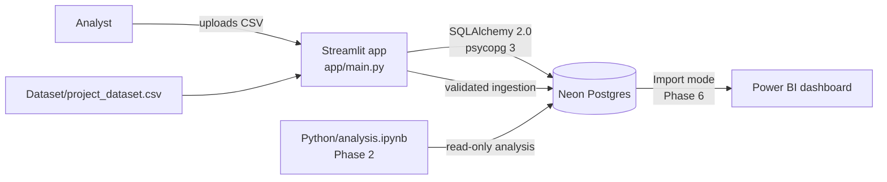

# Cronus — Telecom Churn Intelligence

Cronus is a customer-provider relationship analytics system for telecom churn.
It combines a Python data platform, a Streamlit interface, Neon Postgres, and a
later Power BI dashboard. The project is being built for a Data Analytics with
Python and Power BI internship.

The canonical dataset is [`Dataset/project_dataset.csv`](Dataset/project_dataset.csv).
One row is one customer-provider relationship; `customer_id` is intentionally
non-unique. See [`Dataset/README.md`](Dataset/README.md) for the full data
contract and integrity details.

## Status

Phase 1 — foundation and data platform — is implemented and verified:

- Python 3.13 project managed by uv
- SQLAlchemy 2.0 models and Alembic migration for Neon Postgres
- Robust CSV validation and transactional ingestion
- Streamlit page for connection status, active-dataset summary, upload, and
  dataset activation
- Unit tests, a DB-test suite, Ruff, mypy, and GitHub Actions CI
- Baseline snapshot loaded and verified:
  - 10,000 relationships
  - 8,860 unique customers
  - 19.87% relationship churn (1,987 relationships)
  - 9.56% current customer churn (847 latest relationships)
  - 1,020 multi-provider customers and 33 re-entry pairs

Phase 2 and later phases are not implemented yet.

## Architecture



- The Streamlit upload panel is the only data-loading interface. There is no
  custom CLI, seed script, or console entry point.
- Alembic is the only command-line tool used to change the database schema.
- The application uses the pooled Neon URL; Alembic uses the direct URL.

## Stack

| Layer | Choice |
| --- | --- |
| Runtime | Python 3.13 (`>=3.13,<3.14`), managed by uv |
| UI | Streamlit 1.66+ |
| Data | pandas, NumPy |
| Database | Neon Postgres |
| ORM / SQL | SQLAlchemy 2.0, psycopg 3 |
| Migrations | Alembic |
| Validation / config | Pydantic v2, pydantic-settings |
| Quality | Ruff, mypy, pytest, pytest-cov |
| CI | GitHub Actions |

## Repository layout

```text
.
├── Dataset/
│   ├── project_dataset.csv        # byte-identical committed dataset
│   └── README.md                  # source, SHA-256, shape, semantics
├── Python/.gitkeep                # Phase 2 notebook
├── PowerBI/.gitkeep               # Phase 6 PBIX
├── GitHub/.gitkeep                # Phase 7 final README copy
├── app/
│   └── main.py                    # Streamlit entrypoint
├── src/cronus/
│   ├── __init__.py
│   ├── config.py                  # settings and URL normalisation
│   ├── db.py                      # pooled engine, sessions, status
│   ├── logging.py
│   ├── models.py                  # SQLAlchemy models
│   ├── repository.py              # typed read/activation queries
│   ├── schemas.py                 # Pydantic contracts and errors
│   ├── validation.py              # CSV normalisation and derivation
│   └── ingest.py                  # transactional ingestion service
├── alembic/
│   ├── env.py
│   ├── script.py.mako
│   └── versions/0001_initial_schema.py
├── tests/
│   ├── conftest.py
│   ├── test_config.py
│   ├── test_validation.py
│   └── test_ingest_db.py
├── .github/workflows/ci.yml
├── .streamlit/config.toml
├── .editorconfig
├── .gitattributes
├── .gitignore
├── .env.example
├── .python-version
├── alembic.ini
├── pyproject.toml
├── uv.lock
└── README.md
```

The untouched local original `telecom_churn.csv` stays at the repository root
and is gitignored. `Dataset/project_dataset.csv` is the canonical committed
copy.

## Quickstart

### 1. Prerequisites

- A Neon project. Copy the pooled and direct connection strings from the Neon
  console.
- [uv](https://docs.astral.sh/uv/) installed. The project prepares `uv` at
  `~/.local/bin` during development:

  ```bash
  curl -LsSf https://astral.sh/uv/install.sh | sh
  export PATH="$HOME/.local/bin:$PATH"
  ```

### 2. Configure the environment

```bash
cp .env.example .env
# Edit .env and fill DATABASE_URL and DIRECT_URL.
```

Never commit `.env`. `DATABASE_URL` must be the pooled Neon URL (its host
contains `-pooler`). `DIRECT_URL` must be the direct, unpooled URL used only by
Alembic. Connection strings are normalised to
`postgresql+psycopg://` with `sslmode=require`; passwords are masked in any
display.

### 3. Install and migrate

```bash
uv sync --frozen
uv run alembic upgrade head
```

The migration creates the `datasets` and `customer_relationships` tables. The
application never runs migrations at startup.

### 4. Run the app

```bash
uv run streamlit run app/main.py
```

Open the local Streamlit URL, upload `Dataset/project_dataset.csv`, give the
dataset a name, keep **Activate after load** checked, and click **Load dataset**.
The page then displays the dual-grain summary.

### 5. Run quality checks

```bash
uv run ruff check .
uv run ruff format --check .
uv run mypy src
uv run pytest -m "not db" -q
```

DB tests are opt-in because they write to a dedicated test database:

```bash
# Set TEST_DATABASE_URL to a separate Neon database or branch first.
uv run pytest -m db -q
```

Database tests refuse to run when `TEST_DATABASE_URL` equals `DATABASE_URL`.

## Environment variables

| Variable | Required | Default | Purpose |
| --- | --- | --- | --- |
| `DATABASE_URL` | yes | — | Pooled Neon URL used by the Streamlit app |
| `DIRECT_URL` | no | `DATABASE_URL` | Direct URL used by Alembic; recommended |
| `TEST_DATABASE_URL` | no | — | Separate database/branch for `-m db` tests |
| `APP_ENV` | no | `development` | `development`, `test`, or `production` |
| `LOG_LEVEL` | no | `INFO` | Python logging level |
| `MAX_UPLOAD_MB` | no | `25` | Upload size guard |
| `MAX_UPLOAD_ROWS` | no | `200000` | Upload row guard |

Settings are loaded from the repository-root `.env`, independent of the current
working directory. Environment variables take precedence over the file.

## Using the Streamlit app

- **Connection status**: server version, database, and round-trip latency. A
  clean troubleshooting panel is shown if Neon is unavailable. Credentials are
  never displayed.
- **Active dataset**: relationship count, unique customers, relationship churn,
  current-base churn, multi-provider customers, snapshot date, registration
  window, partner count, re-entry pairs, and a profile table.
- **Upload**: validates the file before writing anything. Hard errors leave the
  database untouched. Warnings are displayed with row numbers.
- **Duplicate hashes**: uploading a byte-identical file shows the existing
  dataset. You can activate it or explicitly confirm replacement.
- **Datasets**: lists all uploads and can activate one dataset atomically.
- **Refresh**: cached reads have a 60-second TTL; the refresh button clears the
  cache immediately.

Phase 1 uploads are local-only. Phase 4 will add an admin-password gate before
the upload panel is exposed in deployment. The app does not contain SQL; it
calls repository and ingestion services only.

## Data dictionary

### Source columns

| Column | Description |
| --- | --- |
| `customer_id` | Customer identifier; repeats across provider relationships |
| `telecom_partner` | Telecom provider |
| `gender` | `M` or `F` |
| `age` | Age, 15–100 |
| `state` | State name |
| `city` | City name |
| `pincode` | Six-digit pincode; synthetic and not a reliable geographic key |
| `date_of_registration` | Registration date (`DD-MM-YYYY` in the source) |
| `num_dependents` | Dependents, 0–20 |
| `estimated_salary` | Estimated salary, greater than zero |
| `calls_made` | Calls made, non-negative |
| `sms_sent` | SMS sent, non-negative |
| `data_used` | Data used, non-negative |
| `churn` | Provider-specific churn flag, 0 or 1 |

### Derived columns

| Column | Meaning |
| --- | --- |
| `record_id` | Surrogate primary key |
| `dataset_id` | Owning uploaded snapshot |
| `source_row_number` | 1-based source data row, excluding the header |
| `relationship_seq` | 1-based order by `(registration_date, source_row_number)` within customer |
| `relationship_count` | Number of provider relationships for the customer |
| `is_latest_relationship` | True for exactly one relationship per customer |
| `tenure_days` | Historical: next registration minus current. Latest: snapshot date minus current |
| `created_at` | Insertion timestamp (UTC) |

## Grain and churn semantics

This section is the most important part of the data contract.

- **Relationships vs customers**: 10,000 rows are 10,000 customer-provider
  relationships, not 10,000 customers. There are 8,860 unique customers.
- **Multi-provider customers**: 1,020 customers have multiple relationships
  (900 with two, 120 with three). This is intentional. Never deduplicate them,
  reject them, or warn that they are duplicates.
- **Re-entry pairs**: 33 customer-provider pairs recur at a later date
  (for example A → B → A). They are legitimate return relationships.
- **Historical relationships**: 1,140 rows are non-latest relationships. All
  1,140 are churned by dataset construction. Do not treat that as independent
  evidence of churn behaviour.
- **Relationship churn**: 1,987 / 10,000 = **19.87%**. This covers all history.
- **Current customer churn**: 847 / 8,860 latest relationships = **9.56%**.
- **Never mix the two rates.** 19.87% is not the current customer churn rate.
- **Tenure**: the dataset has no explicit churn date. For a historical
  relationship, the next registration date is the proxy switch date. For the
  latest relationship, the snapshot date (`2023-05-04`) is the end of
  observation.
- **Pincode**: pincode changes across all 1,020 multi-provider groups and is
  synthetic noise. It is not a reliable geographic key.
- **ML implication**: Phase 3 must model current/latest relationships only.
  Including historical rows would leak the construction rule that every
  non-latest relationship is churned.

## Database schema

### `datasets`

One row per uploaded CSV snapshot:

- UUID primary key, display name, original filename
- unique SHA-256 file hash
- relationship `row_count`, snapshot `as_of_date`
- JSONB `validation_report`
- `is_active` flag with a partial unique index enforcing at most one active
  dataset
- upload timestamp and optional notes

### `customer_relationships`

One row per customer-provider relationship:

- `record_id BIGSERIAL` primary key
- `dataset_id` foreign key with `ON DELETE CASCADE`
- all 14 source fields
- `source_row_number`, `relationship_seq`, `relationship_count`,
  `is_latest_relationship`, `tenure_days`
- check constraints for ranges, six-digit pincodes, sequence consistency, and
  tenure
- unique `(dataset_id, source_row_number)`; **no unique constraint on
  `customer_id`**
- indexes for dataset, churn, latest-churn, customer/date, partner, and state
  access paths

Constraint names follow a stable naming convention (`pk_`, `fk_`, `uq_`, `ck_`,
`ix_`). The initial Alembic revision is reversible.

## Validation and ingestion

`validate_csv` reads UTF-8 with BOM tolerance, keeps every source value as text
while parsing, and normalises:

- trimmed strings
- gender to `M`/`F`
- dates parsed as `DD-MM-YYYY`, then `YYYY-MM-DD`
- six-digit pincodes, including zero-padding and Excel `.0` artifacts
- churn to a boolean
- relationship sequence, latest flag, and tenure

Hard errors (nothing is written):

- empty file or no data rows
- missing or duplicate required columns
- missing values, unparseable dates, non-numeric numbers
- invalid churn values, invalid gender, bad pincodes
- out-of-range age/dependents/salary and negative metrics
- an `as_of_date` earlier than the latest registration date

Warnings (allowed):

- extra columns are dropped
- pincode normalisation
- gender inconsistency for the same customer
- duplicate registration dates that need source-row tie-breaking

Multi-provider records, re-entry pairs, and churned historical relationships are
never warnings.

`ingest_dataframe` recomputes all derived fields, checks the SHA-256 duplicate
hash, optionally replaces an existing dataset, deactivates other datasets when
activating, and inserts the snapshot and all relationships in one transaction.
The app calls this service; no SQL lives in `app/`.

## Testing

| Command | Purpose |
| --- | --- |
| `uv run ruff check .` | Lint all Python |
| `uv run ruff format --check .` | Formatting check |
| `uv run mypy src` | Strict typing for `src` |
| `uv run pytest -m "not db" -q` | Unit tests, no database required |
| `uv run pytest -m db -q` | DB tests against `TEST_DATABASE_URL` |

The unit suite covers the baseline metrics, relationship derivation, error and
warning rules, URL normalisation, password masking, and upload limits. DB tests
create the schema in the test database, ingest the baseline, verify dual-grain
metrics, duplicate rejection, replacement, and activation, then drop their
tables. They are excluded from CI.

## Roadmap

| Phase | Scope | Output |
| --- | --- | --- |
| 1 | Foundation, schema, validation, ingestion, basic Streamlit page | Completed |
| 2 | Exploratory data analysis notebook | `Python/analysis.ipynb` |
| 3 | Current-relationship churn model and evaluation | Python modules + notebook |
| 4 | Full analytics UI and admin-gated deployment workflow | Streamlit pages |
| 5 | Deployment and public Streamlit URL | URL in this README and `GitHub/README.md` |
| 6 | Power BI dashboard in Import mode | `PowerBI/project_dashboard.pbix` |
| 7 | Final documentation and submission README | `01_Project_Documentation.pdf`, `GitHub/README.md` |

## Instructor submission mapping

| Submission item | Location | Phase |
| --- | --- | --- |
| `01_Project_Documentation.pdf` | Repository root | 7 |
| `02_Dataset/project_dataset.csv` | `Dataset/project_dataset.csv` | 1 |
| `03_Python/analysis.ipynb` | `Python/analysis.ipynb` | 2 |
| `05_PowerBI/project_dashboard.pbix` | `PowerBI/project_dashboard.pbix` | 6 |
| `06_GitHub/README.md` | `GitHub/README.md` (root `README.md` is canonical) | 7 |
| `07_Streamlit link` | This README and `GitHub/README.md` | 5 |

If the instructor requires the numbered folder names, the final submission can
map the unnumbered project folders to those item names without duplicating the
source tree.

## Security and credentials

- `.env` and `.streamlit/secrets.toml` are gitignored.
- Full connection URLs are never logged or displayed; passwords are masked.
- Database access is parameterised through SQLAlchemy.
- The upload panel is local-only until Phase 4 adds authentication.
- `TEST_DATABASE_URL` must point to a separate database or branch; DB tests
  refuse to run against the app database.

## Known limitations

- The upload panel is intentionally local-only in Phase 1.
- The dataset has no explicit churn date; tenure uses the documented
  next-registration/snapshot convention.
- The root source CSV is gitignored; the committed dataset is
  `Dataset/project_dataset.csv`.
- Power BI and the deployed Streamlit link are later phases.
