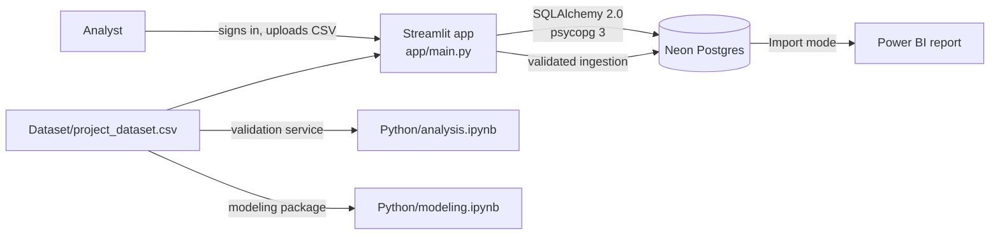

# ChurnLab: Telecom Customer Churn Intelligence and Analysis System

**Live application:** <https://churn-lab.streamlit.app/>

ChurnLab is an end-to-end customer churn analysis platform for a telecom
provider. It combines a validated data platform on PostgreSQL, an exploratory
data analysis notebook, a scikit-learn churn model, a multipage Streamlit
application, and a Power BI report.

The system answers three questions:

1. How much churn exists at the customer-provider relationship grain?
2. Which provider, demographic, tenure, and usage segments carry the highest
   current churn?
3. Which current customers should a retention team review first, at a stated
   decision threshold?

All results are observational. The project makes no causal claim, no
production-readiness claim, and no fairness claim.

- [Project deliverables](#project-deliverables)
- [Key results](#key-results)
- [Architecture](#architecture)
- [Stack](#stack)
- [Repository layout](#repository-layout)
- [Quickstart](#quickstart)
- [Environment variables](#environment-variables)
- [Using the Streamlit app](#using-the-streamlit-app)
- [Dataset](#dataset)
- [Exploratory analysis](#exploratory-analysis)
- [Churn modeling](#churn-modeling)
- [Current-frame analytics and scoring](#current-frame-analytics-and-scoring)
- [Admin workflow](#admin-workflow)
- [Accounts and visitor analytics](#accounts-and-visitor-analytics)
- [Database schema](#database-schema)
- [Validation and ingestion](#validation-and-ingestion)
- [Power BI dashboard](#power-bi-dashboard)
- [Testing](#testing)
- [Security and credentials](#security-and-credentials)
- [Known limitations](#known-limitations)

## Project deliverables

| Deliverable | Location |
| --- | --- |
| Project documentation (PDF) | [`Docs/01_Project_Documentation.pdf`](Docs/01_Project_Documentation.pdf) |
| Canonical dataset | [`Dataset/project_dataset.csv`](Dataset/project_dataset.csv) |
| Exploratory analysis notebook | [`Python/analysis.ipynb`](Python/analysis.ipynb) |
| Modeling and evaluation notebook | [`Python/modeling.ipynb`](Python/modeling.ipynb) |
| Streamlit application | [`app/main.py`](app/main.py), live at <https://churn-lab.streamlit.app/> |
| Power BI report | [`PowerBI/project_dashboard.pbix`](PowerBI/project_dashboard.pbix) |
| Service layer | [`src/cronus/`](src/cronus) |
| Test suite | [`tests/`](tests) |
| Continuous integration | [`.github/workflows/ci.yml`](.github/workflows/ci.yml) |

## Key results

| Measure | Value |
| --- | ---: |
| Customer-provider relationships | 10,000 |
| Unique customers | 8,860 |
| Relationship churn (all history) | 1,987 (19.87%) |
| Current customer churn (latest relationship) | 847 (9.56%) |
| Multi-provider customers | 1,020 |
| Re-entry customer-provider pairs | 33 |
| Holdout PR-AUC | 0.2312 |
| Holdout ROC-AUC | 0.7295 |
| Holdout Brier score | 0.0806 |
| Selected threshold (max-F1) | 0.1840 |
| Review queue at 0.1840 | 1,180 relationships (13.32%) |
| Review queue at 0.0981 (70% recall floor) | 3,286 relationships (37.09%) |

The two churn rates answer different questions. The relationship rate counts
every churn event in the full history. The current rate counts each customer's
latest relationship only. Every page, table, chart, and export keeps the two
rates separate and labelled.

## Architecture



- The Streamlit application is the only data-loading interface and the only
  application interface. There is no custom CLI and no console entry point.
- The administrator account is seeded at application start-up.
- The app has eight pages plus a hidden upload page. Only the administrator can
  replace or activate a dataset. Every signed-in user can stage an upload.
- Both notebooks read the canonical CSV through the validation service. They do
  not connect to the database and need no credentials.
- Alembic is the only command-line tool that changes the database schema.
- The application uses the pooled database URL. Alembic uses the direct URL.
- The internal Python package is `cronus`. The user-facing name is ChurnLab.

## Stack

| Layer | Choice |
| --- | --- |
| Runtime | Python 3.13 (`>=3.13,<3.14`), managed by uv |
| UI | Streamlit 1.67 with Altair 6 for live charts |
| Data | pandas, NumPy |
| Modeling | scikit-learn 1.9 (logistic regression, gradient-boosted tree) |
| Database | Neon Postgres |
| ORM and SQL | SQLAlchemy 2.0, psycopg 3 |
| Migrations | Alembic |
| Validation and config | Pydantic v2, pydantic-settings |
| Notebook tooling | JupyterLab, ipykernel, matplotlib, seaborn, nbconvert |
| Quality | Ruff, mypy, pytest |
| CI | GitHub Actions |

The runtime dependencies are `alembic`, `altair`, `numpy`, `pandas`,
`psycopg[binary]`, `pydantic`, `pydantic-settings`, `scikit-learn`,
`sqlalchemy`, and `streamlit`.
The notebook and quality tools live in separate dependency groups, so a
deployment installs only what the application needs.

## Repository layout

```text
.
├── Docs/
│   └── 01_Project_Documentation.pdf   # submitted project report
├── Dataset/
│   └── project_dataset.csv        # canonical committed dataset
├── Python/
│   ├── analysis.ipynb             # executed exploratory analysis
│   └── modeling.ipynb             # executed modeling and evaluation
├── PowerBI/
│   └── project_dashboard.pbix     # five-page report
├── app/
│   ├── main.py                    # navigation shell and page registration
│   ├── shared.py                  # cached reads, sidebar, charts, UI helpers
│   ├── assets/
│   │   ├── analysis/              # 12 static notebook figures
│   │   └── modeling/              # 10 static notebook figures
│   └── views/
│       ├── overview.py            # dual-grain snapshot summary
│       ├── providers.py           # provider and segment comparisons
│       ├── usage.py               # tenure, usage, cohorts, correlations
│       ├── performance.py         # model card and validation checks
│       ├── predictions.py         # scored review queue and CSV export
│       ├── powerbi.py             # PBIX download and native preview
│       ├── upload.py              # dataset upload for signed-in users
│       ├── account.py             # sign-up, sign-in, session, sign-out
│       └── admin.py               # administrator-only dataset management
├── src/cronus/
│   ├── accounts.py                # account persistence and authentication
│   ├── auth.py                    # scrypt hashing, policy, admin password check
│   ├── config.py                  # settings and URL normalisation
│   ├── db.py                      # pooled engine, sessions, status
│   ├── logging.py
│   ├── models.py                  # SQLAlchemy models
│   ├── repository.py              # typed read and activation queries
│   ├── schemas.py                 # Pydantic contracts and errors
│   ├── validation.py              # CSV normalisation and derivation
│   ├── ingest.py                  # transactional ingestion service
│   ├── analytics.py               # current-grain descriptive tables
│   ├── visitors.py                # anonymous page views and counts
│   └── modeling/
│       ├── features.py            # feature contract, current frame, splits
│       ├── pipelines.py           # preprocessing and candidate pipelines
│       ├── evaluation.py          # metrics, thresholds, calibration
│       ├── serving.py             # final model contract and batch scoring
│       └── training.py            # CV, tuning, final fit, prediction
├── alembic/
│   ├── env.py
│   ├── script.py.mako
│   └── versions/
│       ├── 0001_initial_schema.py
│       ├── 0002_accounts_and_visitors.py
│       └── 0003_admin_account.py
├── tests/                         # unit and database suites
├── scripts/
│   └── _extract_notebook_pngs.py  # refresh app/assets from the notebooks
├── .github/workflows/ci.yml
├── .streamlit/config.toml
├── .env.example
├── alembic.ini
├── pyproject.toml
├── uv.lock
└── README.md
```

The local original `telecom_churn.csv` stays at the repository root and is
gitignored. `Dataset/project_dataset.csv` is the canonical committed copy.

## Quickstart

### 1. Prerequisites

- Python 3.13. The repository pins the version in `.python-version`.
- [uv](https://docs.astral.sh/uv/) for environment and dependency management.
- A Neon project with a pooled connection string and a direct connection
  string.

Install uv if it is missing:

```bash
curl -LsSf https://astral.sh/uv/install.sh | sh
export PATH="$HOME/.local/bin:$PATH"
```

### 2. Configure the environment

```bash
cp .env.example .env
# Edit .env and fill DATABASE_URL and DIRECT_URL.
# Set ADMIN_PASSWORD to a non-empty value.
```

Never commit `.env`. `DATABASE_URL` must be the pooled Neon URL, whose host
contains `-pooler`. `DIRECT_URL` must be the direct URL, which Alembic uses.
Both are normalised to `postgresql+psycopg://` with `sslmode=require`, and
passwords are masked in every display.

Set the seeded administrator account:

```bash
ADMIN_USERNAME=admin
ADMIN_EMAIL=admin@churnlab.local
ADMIN_DISPLAY_NAME=Administrator
ADMIN_PASSWORD=choose-a-long-password
```

The app creates or updates this account at start-up. The account needs no
self-service sign-up and no second password prompt. The seed accepts any
non-empty password because the operator owns the credential. The repository
never contains the value.

The app also accepts a Streamlit secret. Create `.streamlit/secrets.toml`
(gitignored) when you prefer that route:

```toml
admin_password = "choose-a-long-password"
```

The Streamlit secret has priority over `ADMIN_PASSWORD`. If neither value is
set, the seed is skipped and the Admin page stays locked. Upload, replacement,
and activation are then unavailable.

Set the visitor hash salt:

```bash
python -c "import secrets; print(secrets.token_urlsafe(32))"
# Copy the output into .env:
VISITOR_HASH_SALT=the-generated-value
```

The salt is a secret. A blank value disables visitor recording.

### 3. Install and migrate

```bash
uv sync --frozen
uv run alembic upgrade head
```

The migrations create the `datasets`, `customer_relationships`, `app_users`, and
`visitor_events` tables. The application never runs migrations at start-up.

### 4. Run the app

```bash
uv run streamlit run app/main.py
```

Open the local Streamlit URL. The first page is **Account**. Sign in with
`admin` and the `ADMIN_PASSWORD` value, or create a viewer account. To load the
baseline snapshot, click **Upload dataset** in the sidebar, upload
`Dataset/project_dataset.csv`, give the dataset a name, and click **Load
dataset** with **Activate after load** checked. A viewer upload stays inactive.
The administrator can activate it from the **Admin** page.

The app builds the model when you first open **Churn predictions**. The fit runs
in the Streamlit process on the active current-relationship frame. No model file
is written.

### 5. Run the notebooks

The notebooks need no database and no `.env` file. They read
`Dataset/project_dataset.csv` directly.

```bash
uv sync --group notebook
uv run --group notebook jupyter lab Python/analysis.ipynb
uv run --group notebook jupyter lab Python/modeling.ipynb
```

To re-execute a notebook in place and refresh every output:

```bash
uv run --group notebook jupyter nbconvert \
  --to notebook --execute --inplace \
  --ExecutePreprocessor.timeout=900 \
  Python/analysis.ipynb

uv run --group notebook jupyter nbconvert \
  --to notebook --execute --inplace \
  --ExecutePreprocessor.timeout=1800 \
  Python/modeling.ipynb
```

After a notebook figure changes, refresh the static images that the app shows:

```bash
uv run --group notebook python scripts/_extract_notebook_pngs.py
```

### 6. Run quality checks

```bash
uv run ruff check .
uv run ruff format --check .
uv run mypy src
uv run pytest -m "not db" -q
```

Database tests are opt-in because they write to a dedicated test database:

```bash
# Set TEST_DATABASE_URL to a separate Neon database or branch first.
uv run pytest -m db -q
```

The database tests refuse to run when `TEST_DATABASE_URL` equals
`DATABASE_URL`.

## Environment variables

| Variable | Required | Default | Purpose |
| --- | --- | --- | --- |
| `DATABASE_URL` | yes | none | Pooled Neon URL used by the Streamlit app |
| `DIRECT_URL` | no | `DATABASE_URL` | Direct URL used by Alembic, recommended |
| `TEST_DATABASE_URL` | no | none | Separate database or branch for `-m db` tests |
| `APP_ENV` | no | `development` | `development`, `test`, or `production` |
| `LOG_LEVEL` | no | `INFO` | Python logging level |
| `ADMIN_USERNAME` | no | `admin` | Seeded administrator sign-in name |
| `ADMIN_EMAIL` | no | `admin@churnlab.local` | Seeded administrator email address |
| `ADMIN_DISPLAY_NAME` | no | `Administrator` | Seeded administrator display name |
| `ADMIN_PASSWORD` | no | none | Seed password. Blank skips the seed and keeps the Admin page locked |
| `VISITOR_HASH_SALT` | no | none | Secret salt for the visitor HMAC. Blank disables recording |
| `ALLOW_SIGNUP` | no | `true` | Show the create-account form on the Account page |
| `SESSION_MAX_HOURS` | no | `12` | Signed-in session lifetime in hours |
| `MAX_UPLOAD_MB` | no | `25` | Upload size guard |
| `MAX_UPLOAD_ROWS` | no | `200000` | Upload row guard |

Settings load from the repository-root `.env` file, independent of the current
working directory. Environment variables take precedence over the file.

## Using the Streamlit app

The app registers eight pages with `st.navigation` and `st.Page` in
`app/main.py` after sign-in, plus a hidden upload page that the sidebar button
opens. A signed-out visitor gets only the Account page. `app/shared.py` owns
cached database reads, the sidebar, the visitor strip, the chart helpers, and
the reusable display components. Page modules live in `app/views/`.

A compact visitor strip sits above every page, including the sign-in page. It
shows Total Visits, Registered Users, and Active Sessions. The strip never
blocks a page and renders nothing when the database read fails.

The sidebar carries the ChurnLab mark, the active dataset, the connection
status, the refresh control, the account state, and the **Upload dataset**
button. The app uses a dark theme only.

- **Overview**: active dataset name, snapshot date, registration window, unique
  customers, relationship counts, partner count, multi-provider customers,
  re-entry pairs, and the two churn measures side by side. Live charts cover
  provider, gender, age band, tenure band, usage quartiles, and quarterly
  trends.
- **Providers and segments**: current churn by provider, gender, age band, and
  state. Filters cover provider, gender, state, and age. Tables show counts,
  rates, Wilson 95% intervals, and a small-sample flag. Live bar charts show
  every segment.
- **Usage and tenure**: current churn by tenure band, calls, SMS, and data
  quartile, plus registration cohorts. A Spearman table shows rank
  associations. Live bar charts and a correlation chart show every tab.
- **Model performance**: the model card, holdout and cross-validation metrics,
  threshold policies, the confusion matrix at 0.1840, permutation importance,
  subgroup recall, calibration, and the temporal check. Live Altair charts
  cover importance, recall, calibration, and metric comparison.
- **Churn predictions**: a ranked review queue for the active current frame.
  The page offers the two fixed policies. Every metric label, table column,
  filename, and CSV export carries the selected threshold. Live charts show
  the score distribution and the flagged counts by provider.
- **Power BI dashboard**: download the PBIX file and review a native preview of
  the five report pages, rendered from the active dataset.
- **Admin**: dataset replacement and activation, restricted to the
  administrator account. A viewer sees an access message and a pointer to the
  sidebar upload button.
- **Account**: create an account with a display name, a required username, an
  email address, and a password. Sign in with the email or the username, and
  sign out. The page shows the display name, username, email address, and
  member-since date. An administrator badge marks the seeded account. Sign-in
  locks for 60 seconds after five failed attempts in one session.

Every analysis page also has an expandable panel with the static figures from
the analysis and modeling notebooks. The live charts stay the primary view.

Every page except Account requires a signed-in account. Admin actions need the
administrator account.

Cached reads have a 60-second TTL. The sidebar **Refresh data** button clears
both the data cache and the fitted-model cache. Uploads and activations also
clear both caches. The app contains no SQL. It calls repository, account,
visitor, and ingestion services only.

The model is fitted once per active dataset version and cached with
`st.cache_resource`. It uses `fit_final_model` and `predict_churn` with fixed
hyperparameters, 10 features, and no `relationship_count`. The app never
retunes, changes the feature set, or reselects a threshold.

Every export includes a `threshold` column, the policy label, the dataset name,
and the snapshot date. Predictions are never written to the database.

## Dataset

### Source and integrity

| Item | Value |
| --- | --- |
| Original local source | `telecom_churn.csv` (repository root, gitignored) |
| Canonical committed copy | `Dataset/project_dataset.csv` |
| SHA-256 (both files) | `a1c3992fcb8da9523aa0f8074f87ce0c2247cac551e3a4fdee02c2690aa2f048` |
| Size | 842,073 bytes |
| Shape | 10,000 data rows and 14 source columns |
| Snapshot date | 2023-05-04 |
| Registration date range | 2020-01-01 to 2023-05-04 |
| Missing values | None |
| Exact duplicate rows | None |

The two files are byte-identical. The root file is the untouched local
original. `Dataset/project_dataset.csv` is committed to the repository and
uploaded through the app.

### Grain

One row is one customer-provider relationship, not one unique customer.

- 10,000 customer-provider relationships.
- 8,860 unique `customer_id` values.
- 1,020 customers have more than one provider relationship:
  - 7,840 customers have one relationship.
  - 900 customers have two relationships.
  - 120 customers have three relationships.
- 33 customer-provider pairs recur at a later date, for example A to B to A.
  These are legitimate return relationships, not duplicates.
- 1,140 relationships are historical, that is non-latest. All 1,140 are
  churned by dataset construction.
- 8,860 relationships are each customer's latest relationship.

`customer_id` is intentionally non-unique. Never deduplicate the file, reject
multi-provider customers, or warn that a returning customer-provider pair is a
duplicate.

### Churn semantics

| Measure | Definition | Count | Rate |
| --- | --- | --- | --- |
| Relationship churn | All 10,000 relationships with `churn = 1` | 1,987 | 19.87% |
| Current customer churn | Latest relationship per customer with `churn = 1` | 847 | 9.56% |

Relationship churn covers the full history and must never be presented as the
current customer churn rate. Current churn uses each customer's latest provider
relationship only.

### Source columns

| Column | Type | Description |
| --- | --- | --- |
| `customer_id` | text | Customer identifier, repeats across provider relationships |
| `telecom_partner` | text | Provider: Airtel, BSNL, Reliance Jio, or Vodafone |
| `gender` | text | `M` or `F` |
| `age` | integer | Customer age, 15 to 100 |
| `state` | text | State name (32 states) |
| `city` | text | City name (81 cities) |
| `pincode` | text | Six-digit pincode, synthetic and not a reliable geographic key |
| `date_of_registration` | date | Provider registration date in `DD-MM-YYYY` format |
| `num_dependents` | integer | Number of dependents, 0 to 20 |
| `estimated_salary` | integer | Estimated salary, greater than zero |
| `calls_made` | integer | Calls made, non-negative |
| `sms_sent` | integer | SMS sent, non-negative |
| `data_used` | integer | Data used, non-negative |
| `churn` | integer | Provider-specific churn flag: 1 churned, 0 retained |

### Derived columns

| Column | Meaning |
| --- | --- |
| `record_id` | Surrogate primary key |
| `dataset_id` | Owning uploaded snapshot |
| `source_row_number` | 1-based source data row, excluding the header |
| `relationship_seq` | 1-based order by `(registration_date, source_row_number)` within a customer |
| `relationship_count` | Number of provider relationships for the customer |
| `is_latest_relationship` | True for exactly one relationship per customer |
| `tenure_days` | Historical: next registration date minus current date. Latest: snapshot date minus current date |
| `created_at` | Insertion timestamp (UTC) |

The dataset has no explicit churn date. The next registration date is the proxy
switch date for a historical relationship. The snapshot date is the end of
observation for the latest relationship.

### Data-quality notes

- Gender is stable within a customer in this snapshot. The validator warns when
  a future file contains inconsistent gender for one customer.
- Age changes in 722 multi-provider groups and state changes in 157.
- Pincode changes in all 1,020 multi-provider groups. It is synthetic noise, so
  it is not a stable geographic key.
- The validator normalises gender to `M` or `F`, trims text, parses dates, and
  zero-pads short pincodes. These produce warnings, not rejections.
- Multi-provider records, re-entry pairs, and churned historical relationships
  are valid observations and are never treated as duplicates.
- The 1,140 historical rows are churned by construction. Including them in a
  model would leak that rule, so modeling uses current relationships only.

## Exploratory analysis

The notebook at `Python/analysis.ipynb` reads the canonical CSV through
`cronus.validation.validate_csv`. It checks the SHA-256 hash and the file size
before analysis. It needs no database connection and no credentials.

It keeps the relationship grain and reports the two churn measures side by
side:

- **Relationship churn (all history):** 1,987 of 10,000, or 19.87%.
- **Current customer churn (latest only):** 847 of 8,860, or 9.56%.

The notebook covers:

1. Snapshot verification against the data contract.
2. Grain, duplicate checks, and attribute stability across relationships.
3. Univariate distributions.
4. Provider, gender, age, dependents, and state comparisons.
5. Tenure bands and usage quartiles.
6. Spearman correlations and segment interaction.
7. Registration cohorts and the modeling feature contract.

Main descriptive findings:

- Usage intensity has the strongest association with current churn. Churn
  falls from about 16 to 18 percent in the lowest calls, SMS, or data quartile
  to about 3 percent in the highest quartile.
- BSNL has the highest current churn at 16.0 percent (266 of 1,664). Reliance
  Jio has the lowest at 5.9 percent (154 of 2,603).
- Current churn falls from 12.1 percent at 0 to 90 days of tenure to 6.6
  percent after two years.
- Older age bands and fewer dependents associate with higher current churn.
  Gender shows no material difference.
- Recent registration cohorts show higher current churn, which is consistent
  with their shorter tenure at the snapshot.

All findings are descriptive. The notebook makes no causal claim.

The notebook has 55 cells (25 markdown, 30 code) and 12 figures. A full
re-execution produces 30 code cells with sequential execution counts, no error
output, and no stderr output.

## Churn modeling

The modeling work trains and evaluates the churn model on the 8,860 current
relationships. It never uses the 1,140 historical rows. The package is in
`src/cronus/modeling/`, and the executed notebook is `Python/modeling.ipynb`.

### Model card

| Item | Value |
| --- | --- |
| Model | Logistic regression with L2 penalty |
| Grain | One current customer-provider relationship |
| Target | `churn` |
| Training rows | 8,860 |
| Churn events | 847 (9.56%) |
| Features | 10 |
| Validation | Stratified five-fold CV plus an 80/20 holdout |
| Threshold | 0.1840 (max-F1 on out-of-fold predictions) |
| Holdout PR-AUC | 0.231 (95% CI 0.191 to 0.293) |
| Holdout ROC-AUC | 0.729 (95% CI 0.688 to 0.765) |
| Holdout Brier score | 0.081 (95% CI 0.078 to 0.083) |
| Artifact | None. The app refits and caches the pipeline. |

### Scope and feature contract

The loader filters to `is_latest_relationship` and raises an error when a
customer appears twice on that grain. It never deduplicates rows. The target is
`churn` for the latest relationship. The final model uses 10 features:

- Categorical: `telecom_partner`, `gender`, `state`.
- Numeric: `age`, `num_dependents`, `estimated_salary`, `calls_made`,
  `sms_sent`, `data_used`, `tenure_days`.

The model excludes identifiers (`customer_id`, `record_id`, `dataset_id`,
`source_row_number`), unstable geography (`pincode`, `city`), bookkeeping fields
(`is_latest_relationship`, `relationship_seq`, `created_at`), and
`date_of_registration`. The registration date is used only for the temporal
check. `relationship_count` is tested and dropped after the ablation.

Rare states are grouped with `OneHotEncoder(min_frequency=50)`. Unseen
categories are ignored. All preprocessing is fitted inside the pipeline.

### Validation design

The notebook asserts the file SHA-256 and the 8,860-row current frame before
training. The primary split is stratified 80/20. The test frame has 1,772
relationships and 169 churn events (9.54%). Model selection uses five
stratified folds on the training frame only. PR-AUC is the primary metric
because churn is the minority class at 9.56%. ROC-AUC, Brier score, and log
loss are secondary checks.

| Candidate | Features | CV PR-AUC | CV ROC-AUC | CV Brier |
| --- | ---: | ---: | ---: | ---: |
| Logistic regression | 11 | 0.2676 ± 0.0532 | 0.7499 | 0.0794 |
| Gradient-boosted tree | 11 | 0.2400 ± 0.0475 | 0.7362 | 0.0810 |
| Logistic regression (final) | 10 | 0.2662 ± 0.0493 | 0.7497 | 0.0794 |

The tree loses on PR-AUC and Brier score. Dropping `relationship_count` changes
CV PR-AUC by -0.0014, which is small against the fold standard deviation. The
final model is the simpler 10-feature logistic regression.

### Threshold policy

The default 0.5 threshold is not usable. The model rarely predicts above 0.5,
so 0.5 catches only 2 of 169 holdout churners.

The notebook selects the threshold on out-of-fold training predictions:

- **Max-F1:** 0.1840. Holdout precision 0.241, recall 0.337, F1 0.281.
- **70% recall floor:** 0.0981. Holdout precision 0.172, recall 0.669, F1
  0.273.

Max-F1 is the reported policy. The 70% alternative applies when contact
capacity is higher. Every score must travel with its threshold.

### Holdout results

| Metric | Estimate | 95% bootstrap interval |
| --- | ---: | ---: |
| PR-AUC | 0.2312 | 0.1909 to 0.2926 |
| ROC-AUC | 0.7295 | 0.6884 to 0.7654 |
| Brier score | 0.0806 | 0.0778 to 0.0834 |

At the max-F1 threshold the confusion matrix is 1,423 true negatives, 180 false
positives, 112 false negatives, and 57 true positives.

### Interpretation and checks

- **Permutation importance:** `telecom_partner` (0.0434), `data_used` (0.0320),
  `calls_made` (0.0231), and `tenure_days` (0.0178) have the largest holdout
  drops. These are associations, not causal effects.
- **Calibration:** the largest quantile-bin gap is -0.036. The curve stays near
  the diagonal, but individual probabilities are not exact churn rates.
- **Subgroup recall:** at the selected threshold, provider recall is BSNL 0.577,
  Airtel 0.375, Vodafone 0.178, and Reliance Jio 0.125. The highest calls
  quartile has 0.000 recall, so high-usage churners are under-flagged.
- **Temporal check:** train on 2020 to 2021 and test on 2022 to 2023. Test
  PR-AUC is 0.2776, ROC-AUC is 0.7450, and Brier is 0.0941. The newer period
  has 11.55% churn, so prevalence and calibration shift.

The notebook has 43 cells (15 markdown, 28 code) and 10 figures. A full
re-execution produces 28 code cells with sequential execution counts, 10
figures, no error output, and no stderr output.

### Serving contract

`src/cronus/modeling/serving.py` holds the fixed serving contract:

- Model: logistic regression with 10 features and `C=0.1`.
- Default threshold: 0.1840.
- Alternative threshold: 0.0981 at a 70% recall floor.
- Model card, permutation importance, subgroup recall, calibration bins, and
  temporal check values.
- `fit_scoring_model`, `score_current_relationships`, and `summarize_scores`.

The app refits the final pipeline on all current relationships of the active
dataset with the selected hyperparameters and threshold. No model artifact is
committed. The app imports `fit_final_model` and `predict_churn`, fits on the
active dataset, and caches the pipeline in the Streamlit process. It adds no
database write, schema change, model artifact, or prediction table.

All results are observational. The project reports descriptive and predictive
results only.

## Current-frame analytics and scoring

`get_current_relationships` reads only rows with `is_latest_relationship =
TRUE`. It aliases the database `registration_date` column to
`date_of_registration`, returns the stored `tenure_days`, normalises dtypes, and
raises an error when a customer appears twice on the current grain. It never
deduplicates rows.

`src/cronus/analytics.py` adds the descriptive table helpers that the pages use:

- Wilson 95% churn intervals.
- Provider, gender, age-band, and state tables.
- Tenure bands, usage quartiles, and registration cohorts.
- Spearman rank correlations.
- Current-frame filters that reject historical rows and duplicate customers.

The scored queue contains one row per current customer-provider relationship. It
includes `score_rank`, `churn_probability`, `predicted_churn`,
`review_priority`, and a constant `threshold` column. It never includes the
observed `churn` target.

## Admin workflow

The Admin page is the only page with dataset replacement and activation
controls. Upload is handled by a separate hidden page that the **Upload
dataset** button in the sidebar opens.

1. When the signed-in account has `is_admin`, the controls open directly. The
   account already passed its password check on the Account page.
2. Otherwise, the page shows an access message that points to the sidebar
   upload button. Only the administrator account can replace or activate a
   dataset.

The password is never displayed, logged, stored in the database, or written to
an export. Sign-in lasts for the Streamlit browser session. The sidebar shows
the administrator state and provides sign-out.

A signed-in user can upload a dataset from the sidebar. The load leaves the new
dataset inactive. Only the administrator can replace or activate a dataset.

Uploads run the existing validation and ingestion services. Validation errors
leave the database unchanged. A byte-identical file offers activation of the
existing dataset or an explicit replacement. Activation is atomic, and a
successful upload or activation clears the data and model caches.

## Accounts and visitor analytics

Migration `0002_accounts_and_visitors.py` adds two tables, and migration
`0003_admin_account.py` extends `app_users`.

- `app_users` stores one row per account: case-folded unique email, optional
  unique lowercase username, display name, scrypt password hash, admin flag,
  active flag, created date, and last sign-in date.
- `visitor_events` stores one row per throttled page view: a 32-character
  visitor digest, the Streamlit session id, an optional account id, the page
  path, and the timestamp.

Accounts are local to the application. Sign-up asks for a display name, a
username, an email address, a password, and a password confirmation. The
username must be 3 to 40 characters, using lowercase letters and numbers only.
The password policy is 12 to 128 characters with no composition rules, and the
password must not equal the email address or the display name.

Passwords use `hashlib.scrypt` from the standard library with `n=16384`, `r=8`,
`p=1`, a random 16-byte salt, and a 64-byte digest. Each hash carries its own
parameters in `scrypt$n$r$p$salt$hash` form, so a future parameter change needs
no schema change. Verification uses `hmac.compare_digest`. An unknown email
still runs one hash against a dummy value, so a failed lookup takes the same
time as a wrong password.

### Seeded administrator

Migration `0003` adds `username` and `is_admin` to `app_users`. At start-up,
`app/main.py` calls `seed_admin_account()`, which runs once per process through
`st.cache_resource`. The seed reads `ADMIN_USERNAME`, `ADMIN_EMAIL`,
`ADMIN_DISPLAY_NAME`, and the password that `configured_admin_password()`
resolves.

- When no account matches the username or email, the seed creates one with
  `is_admin=true`.
- When the account exists, the seed sets `is_admin=true`, reactivates it, and
  updates the hash when the configured password changed.
- The seed catches database errors and logs them. The app still opens.
- The seed skips the 12-character self-service policy because the operator owns
  the credential. Use a long value anyway.

Sign-in accepts a username or an email. The seeded account uses one password
for the Account page sign-in, which also grants access to the Admin page. Viewer
accounts cannot access the Admin page. Change `ADMIN_PASSWORD` or the
`admin_password` secret and restart the process to rotate the password. A
change to `ADMIN_USERNAME` creates a new account and leaves the old row in
place.

The signed-in session lives in `st.session_state` and ends after
`SESSION_MAX_HOURS`, or when the browser opens a new Streamlit session. Sign-out
clears the account, the admin gate, and any pending lock state. The app stores
no session cookie.

### Visitor metrics

The visitor strip counts distinct `visitor_key` values. The key is
`HMAC-SHA256(salt, "<ip>|<user-agent>")`, truncated to 32 hexadecimal
characters. The application never stores the raw IP address or the raw user
agent. On localhost, where Streamlit reports no IP address, the session id
replaces the IP so local runs still produce counts.

One session writes at most one row per page per 30 minutes, and the throttle
state lives in the Streamlit session. A presence update runs at most once per
60 seconds.

The strip shows:

- **Total Visits**: distinct Streamlit sessions with activity in the last 7 days.
- **Registered Users**: the active account count.
- **Active Sessions**: distinct sessions with activity in the last 5 minutes.

Set `VISITOR_HASH_SALT` to a long random string before you deploy. A blank salt
disables recording, and the strip then shows the stored counts with a caption
that explains the state. The salt is a secret because the digest is
pseudonymous, not anonymous. A person who knows the salt and guesses an IP
address and user agent can confirm a match.

Account sign-up is open by default and no verification email is sent. The gate
controls casual access and demonstrates authentication. It does not protect
sensitive data. Set `ALLOW_SIGNUP=false` after you create the accounts you need.

## Database schema

### `datasets`

One row per uploaded CSV snapshot:

- UUID primary key, display name, original filename.
- Unique SHA-256 file hash.
- Relationship `row_count` and snapshot `as_of_date`.
- JSONB `validation_report`.
- `is_active` flag with a partial unique index that enforces at most one active
  dataset.
- Upload timestamp and optional notes.

### `customer_relationships`

One row per customer-provider relationship:

- `record_id BIGSERIAL` primary key.
- `dataset_id` foreign key with `ON DELETE CASCADE`.
- All 14 source fields.
- `source_row_number`, `relationship_seq`, `relationship_count`,
  `is_latest_relationship`, and `tenure_days`.
- Check constraints for ranges, six-digit pincodes, sequence consistency, and
  tenure.
- Unique `(dataset_id, source_row_number)`, with no unique constraint on
  `customer_id`.
- Indexes for dataset, churn, latest-churn, customer and date, partner, and
  state access paths.

Constraint names follow a stable naming convention (`pk_`, `fk_`, `uq_`, `ck_`,
`ix_`). Every migration is reversible.

### `app_users` and `visitor_events`

- `app_users` holds the account rows described in the previous section.
- `visitor_events` holds throttled page views, indexed by `viewed_at` and by
  session.

## Validation and ingestion

`validate_csv` reads UTF-8 with BOM tolerance, keeps every source value as text
while parsing, and normalises:

- Trimmed strings.
- Gender to `M` or `F`.
- Dates parsed as `DD-MM-YYYY`, then `YYYY-MM-DD`.
- Six-digit pincodes, including zero-padding and Excel `.0` artifacts.
- Churn to a boolean.
- Relationship sequence, latest flag, and tenure.

Hard errors stop the load and write nothing:

- Empty file or no data rows.
- Missing or duplicate required columns.
- Missing values, unparseable dates, or non-numeric numbers.
- Invalid churn values, invalid gender, or bad pincodes.
- Out-of-range age, dependents, or salary, and negative metrics.
- An `as_of_date` earlier than the latest registration date.

Warnings allow the load:

- Extra columns are dropped.
- Pincode normalisation.
- Gender inconsistency for the same customer.
- Duplicate registration dates that need source-row tie-breaking.

Multi-provider records, re-entry pairs, and churned historical relationships are
never warnings.

`ingest_dataframe` recomputes all derived fields, checks the SHA-256 duplicate
hash, optionally replaces an existing dataset, deactivates other datasets when
activating, and inserts the snapshot and all relationships in one transaction.
The app calls this service. No SQL lives in `app/`.

## Power BI dashboard

The report is built in **Import mode** against Neon Postgres. Scoring is
computed in **Power Query (M)**. The queries replicate the baseline
preprocessing (`OneHotEncoder` with `min_frequency=50`, `StandardScaler`) and
apply the fixed logistic regression coefficients. The PBIX does not read a
scored CSV and does not call Python at view time.

The Streamlit **Power BI dashboard** page offers a PBIX download and a native
preview of the five report pages, rendered from the active dataset.

### File

| File | Purpose |
| --- | --- |
| `PowerBI/project_dashboard.pbix` | Five-page report |

The Power Query scripts, DAX measures, build guide, model export, and parity
check script are not committed to this repository. They are available in the
project archive if needed for rebuilding the report.

### Data model

- `Config`: one record of fixed parameters. Load is disabled.
- `ActiveDataset`: the single active snapshot with the dual-grain summary.
- `CurrentRelationships`: latest relationships only. Intermediate query, load
  is disabled.
- `ScoredRelationships`: computed in M. Adds `churn_probability`, both fixed
  flags, both priorities, both thresholds, and `score_rank`.
- `DateTable`: disconnected calendar.

The model has no relationships. `ActiveDataset` is a one-row constant table.
`ScoredRelationships` is the only fact table. The evidence tables on the Model
performance page are fixed and disconnected.

### Report pages

1. **Overview**: dual-grain churn KPIs, snapshot context, grain warning.
2. **Providers and segments**: provider, gender, age band, and state tables
   with Wilson 95% intervals.
3. **Usage and tenure**: tenure bands, usage quartiles, registration cohorts.
4. **Model performance**: baseline holdout metrics, confusion matrix,
   permutation importance, subgroup recall, calibration, temporal check.
5. **Churn predictions**: threshold selector (0.1840 or 0.0981), ranked queue,
   and both fixed flags.

### Build steps

The Power BI report is pre-built as `PowerBI/project_dashboard.pbix`. To rebuild it:

1. Open Power BI Desktop, then Transform Data, New Source, Blank Query.
2. Create the five Power Query queries (Config, ActiveDataset, CurrentRelationships, DateTable, ScoredRelationships) replicating the baseline preprocessing and fixed logistic regression coefficients.
3. Disable load for `Config` and `CurrentRelationships`.
4. Set `PG_Server` and `PG_Database` in `Config`. Enter the Neon credentials in the Power BI prompt. Do not put the password in a file.
5. Add the DAX measures and calculated columns.
6. Build the five report pages.
7. Publish to Power BI Service and configure daily scheduled refresh.

The repository contains only the final PBIX file. The Power Query scripts, DAX objects, build guide, model export, and parity check script are not committed.

## Testing

| Command | Purpose |
| --- | --- |
| `uv run ruff check .` | Lint all Python and notebooks |
| `uv run ruff format --check .` | Formatting check |
| `uv run mypy src` | Strict typing for `src` |
| `uv run pytest -m "not db" -q` | Unit tests, no database required |
| `uv run pytest -m db -q` | Database tests against `TEST_DATABASE_URL` |

The unit suite currently reports **159 passed and 13 deselected**. The deselected
tests need a live test database.

The unit suite covers the baseline metrics, relationship derivation, error and
warning rules, URL normalisation, password masking, upload limits, admin
password verification, scrypt hashing, account policy, visitor-key hashing, the
page-view throttle, username normalisation, current-frame analytics, and the
serving contract. The analytics tests check Wilson intervals, segment coverage,
ordered bands, usage quartiles, cohorts, filters, and rejection of historical or
duplicate current rows. The serving tests check the fixed constants, model fit
on the full current frame, score coverage, threshold flags, review-priority
bands, summary counts, and input immutability.

Database tests create the schema in the test database, ingest the baseline,
verify dual-grain metrics, duplicate rejection, replacement, and activation,
then drop their tables. The account database tests also create and authenticate
accounts, reject duplicate emails, set `last_login_at`, seed the administrator
account, update its password, and check visitor distinct counts. CI runs the
unit suite only.

## Security and credentials

- `.env` and `.streamlit/secrets.toml` are gitignored.
- Full connection URLs are never logged or displayed. Passwords are masked.
- Database access is parameterised through SQLAlchemy.
- Account passwords use scrypt with a random 16-byte salt and
  `hmac.compare_digest`. No plaintext or reversible value is stored.
- Every dashboard page requires an active account session.
- Upload, replacement, and activation require the administrator account.
- The admin password is never displayed. The seeded hash is stored in
  `app_users`, never in the repository.
- Visitor keys are truncated HMAC-SHA256 digests. The application stores no raw
  IP address, raw user agent, or cookie value.
- `VISITOR_HASH_SALT` is a secret. Keep it out of the repository. Rotate it only
  when you accept that the visitor counts restart.
- `TEST_DATABASE_URL` must point to a separate database or branch. The database
  tests refuse to run against the application database.

## Known limitations

- The dataset is a fixed snapshot dated 2023-05-04. The model and the report
  describe that snapshot. A refresh needs a new upload and, for Power BI, a new
  coefficient export.
- The dataset has no explicit churn date. Tenure uses the documented
  next-registration and snapshot convention.
- The 1,140 historical relationships are churned by construction, so current
  churn is the only modelling target.
- The default 0.5 threshold is unusable. The selected max-F1 threshold is
  0.1840, and every score travels with it.
- Subgroup recall is uneven. Provider recall ranges from 0.125 to 0.577, and the
  highest calls quartile has 0.000 recall.
- The temporal holdout has a higher churn prevalence and a worse Brier score
  than the random holdout. The app keeps the fixed threshold.
- Individual probabilities are calibrated on average but are not exact churn
  rates for a single customer.
- Several states and segments have small samples. Confidence intervals show
  the uncertainty where possible.
- No model artifact is committed. The app refits and caches the pipeline per
  active dataset version.
- The administrator seed runs once per Streamlit process. A password change
  needs a restart, and a database outage at start-up skips the seed until the
  next run.
- A change to `ADMIN_USERNAME` creates a new account and leaves the old row.
- Account sign-up is open and no verification email is sent. The gate
  demonstrates authentication and does not protect sensitive data.
- A full browser reload creates a new Streamlit session, so the viewer signs in
  again. The app stores no persistent session cookie.
- Visitor counts are approximate. Network address translation or a shared
  address can merge two people into one visitor, and a mobile address change
  can split one person into two.
- The visitor strip shows stored counts when `VISITOR_HASH_SALT` is blank, and
  it records nothing in that state.
- Power BI applies the fixed coefficients to the active frame. Streamlit refits
  on the active frame, so the two paths match only for the snapshot that
  produced `powerbi_model_export.json`. Regenerate the export before you
  compare scores on a different dataset.
- The Power BI report was prepared on Linux. Steps that need Power BI Desktop
  run on Windows, and `PBIX_Build_Guide.md` lists them.
- The model describes associations in one snapshot of one provider. It makes no
  causal or fairness claim.
